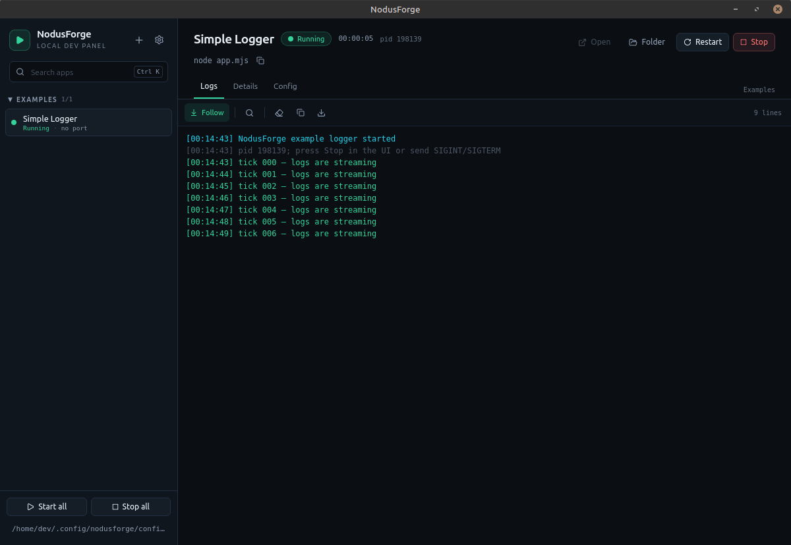

<div align="center">

# NodusForge

**A desktop control panel for local development processes.**

Start, stop, restart and watch APIs, workers and SPAs from one window — with
dependency ordering, health-aware status and live colored logs.

[](https://tauri.app)
[](https://react.dev)
[](https://www.typescriptlang.org)
[](https://www.rust-lang.org)
[](#requirements)
[](#requirements)
[](#requirements)

[](assets/screenshot.png)

</div>

## What is NodusForge?

NodusForge is a lightweight cross-platform desktop app for running a local
development stack without keeping a dozen terminal tabs open. Each app is a YAML
entry with a folder and a shell command. Click **Start**, and NodusForge
supervises the process, waits for its port or health endpoint, and streams
stdout/stderr with colors intact.

Supported targets: Linux x86_64 (`.deb`), Windows 10/11 x64 (NSIS `.exe`) and
macOS 11+ on Apple Silicon (`.dmg`/`.app`). Linux remains the primary
development platform.

It runs processes **natively on the host** — no container runtime or Compose
file required.

> :sound: **AI assistance disclosure:** NodusForge was initially created with the help
> of AI-assisted development tools. The author does not claim authorship of the
> entire codebase and is disclosing this in the interest of transparency and
> openness.

## Features

- **YAML configuration** — one entry per app, optional per-repo includes.
- **Process-tree control** — each command runs in its own process group, so
  Stop terminates the whole tree instead of leaving orphaned `dotnet` or
  `node` children.
- **Health-aware status** — `Starting` becomes `Running` only when the TCP port
  or HTTP endpoint answers. Port conflicts are detected before spawning.
- **Dependency ordering** — `dependsOn` starts services in order and stops them
  in reverse.
- **Live logs** — xterm.js view with ANSI colors, follow-tail, search, copy,
  download, a bounded in-memory buffer and optional persistence to disk.
- **Add-app wizard** — detects .NET projects (including `launchSettings.json`
  ports) and Vite projects (npm/pnpm/yarn/bun).
- **Git branch switching** — the app header shows a branch picker when the app
  folder belongs to a Git repository. Git remains optional.
- **Docker containers** — an optional Containers view lists local containers,
  shows details and supports start/stop. Compose containers appear as ordinary
  containers.
- **ActivityBar** — switch between Apps, Containers and Settings from a compact
  left rail.
- **Automatic updates** — installed builds check GitHub Releases, verify signed
  packages and can install updates in-app.
- **Tray integration** — Show/Quit menu, close-to-tray and optional
  start-on-login.
- **Native packaging** — Tauri 2 bundles for Debian, Windows NSIS and macOS.

## Requirements

| Platform | Requirements |
| --- | --- |
| Linux | Linux Mint 22.x / Ubuntu 24.04 is the primary target. Node.js 20.19+ or 22.12+, Rust stable 1.90+, GTK 3, WebKitGTK 4.1 and libayatana-appindicator development headers, `dpkg`. |
| Windows | Windows 10/11 x64. Node.js 20.19+ or 22.12+, Rust stable with the MSVC toolchain, Visual Studio 2022 C++ Build Tools and the Windows SDK. WebView2 is included with Windows 11. |
| macOS | macOS 11+ on Apple Silicon. Xcode Command Line Tools, Node.js 20.19+ or 22.12+ and Rust stable. |
| Any platform | Whatever the managed apps need: .NET SDK, Go, Yarn, Python, etc. Optional `git` for the branch picker and `docker` with a reachable daemon for the Containers view. |

Install the build prerequisites:

```bash
# Linux Debian/Ubuntu (needs sudo)
bash scripts/install-deps.sh

# macOS (checks Xcode CLT, Node and Rust; --install runs supported installers)
bash scripts/setup-macos.sh --install

# Windows PowerShell
powershell -ExecutionPolicy Bypass -File scripts/setup-windows.ps1 -Install
```

## Run locally

```bash
git clone <repository-url>
cd nodusforge
npm ci
```

Linux:

```bash
npm run desktop
```

`npm run desktop` loads the Rust toolchain, checks the GTK/WebKit
dependencies, then starts Vite and the Tauri window.

macOS and Windows:

```bash
npm run tauri dev
```

If `cargo` is not on your `PATH` on Linux:

```bash
source "$HOME/.cargo/env"
npm run tauri dev
```

The config file is created on first launch at the platform-native location:

| Platform | Config |
| --- | --- |
| Linux | `~/.config/nodusforge/config.yaml` |
| Windows | `%APPDATA%\nodusforge\config.yaml` |
| macOS | `~/Library/Application Support/nodusforge/config.yaml` |

## Build

Build the native bundle on each target OS:

```bash
npm run build:app
```

`build:app` runs the checks, selects the platform bundle, builds it and copies
the unsigned artifacts plus a manifest fragment into the shared release-assets
directory next to the repository:

```
../release-assets/v<version>/platforms/<platform>/
```

Override it with `NODUSFORGE_RELEASE_ASSETS=/path/to/release-assets`.

Tauri cannot reliably cross-build macOS or Windows from Linux. Build on each
target OS, a matching VM, or use the optional GitHub Actions workflow.

### Optional GitHub Actions build

Run **Actions → Build artifacts → Run workflow** and choose `all`, `linux`,
`windows` or `macos`. The workflow only builds and uploads artifacts; it does
not sign, tag or publish. Download the artifacts from the run page or with:

```bash
gh run download <run-id> -D ../release-assets/v<version>/platforms
```

The workflow is optional. Local builds on the three operating systems use the
same artifact layout.

## Sign and release

Updater signing happens only on the Linux workstation. The Windows/macOS build
machines and GitHub Actions never receive the private key.

1. Build Linux, Windows and macOS artifacts.
2. Copy or download all platform directories into
   `../release-assets/v<version>/platforms/{linux,windows,macos}` on Linux.
3. Create `../release-assets/v<version>/RELEASE_NOTES.md`.
4. Sign the updater artifacts on Linux:

```bash
export TAURI_SIGNING_PRIVATE_KEY="$HOME/.tauri/myapp.key"
# export TAURI_SIGNING_PRIVATE_KEY_PASSWORD="..." # only if encrypted
npm run release:sign
```

5. Generate `latest.json`, checksums and the release staging directory:

```bash
npm run release:stage
```

Staging requires Linux, Windows and macOS by default. For a local partial test,
pass `-- --require-platforms linux`.

6. Commit and tag the version-bump commit, push it, then publish:

```bash
npm run release:publish
```

`release:publish` requires a clean tree and a tag at `HEAD`; it uses the GitHub
CLI and marks the release **Latest**.

### Install

Linux:

```bash
sudo dpkg -i ../release-assets/v<version>/platforms/linux/NodusForge_<version>_amd64.deb
sudo apt-get -f install   # only if dependencies are missing
```

Windows: run `NodusForge_<version>_x64-setup.exe`.

macOS: open `NodusForge_<version>_aarch64.dmg` and drag **NodusForge** into
**Applications**.

Windows and macOS builds are currently unsigned. Expect SmartScreen or
Gatekeeper warnings. On macOS, an unsigned first launch may need:

```bash
xattr -dr com.apple.quarantine /Applications/NodusForge.app
```

The first Windows/macOS `.exe`/`.dmg` install is manual. In-app updates start
with the next release, because no earlier native build exists.

## Configuration

Config lookup order:

1. `--config <path>`
2. `$NODUSFORGE_CONFIG`
3. `./nodusforge.yaml` in the launch directory
4. platform-native config:

| Platform | Path |
| --- | --- |
| Linux | `~/.config/nodusforge/config.yaml` |
| Windows | `%APPDATA%\nodusforge\config.yaml` |
| macOS | `~/Library/Application Support/nodusforge/config.yaml` |

Paths support `~` and `$VAR` on every platform. Windows additionally supports
`%VAR%`.

### Example

```yaml
version: 1

settings:
  closeToTray: true
  autostart: false
  logBufferLines: 5000
  persistLogs: true
  autoCheckUpdates: true

groups:
  - { id: backend, name: Backend }
  - { id: frontend, name: Frontend }

apps:
  - id: api
    name: API
    group: backend
    cwd: ~/Projects/example-api
    command: dotnet run --project src/Api
    envFile: .env
    url: http://localhost:5080
    health: { type: tcp, port: 5080, timeoutMs: 180000 }
    stopSignal: SIGINT
    stopTimeoutMs: 15000

  - id: web
    name: Web
    group: frontend
    cwd: ~/Projects/example-web
    command: yarn dev
    envFile: .env
    url: http://localhost:5173
    health: { type: tcp, port: 5173, timeoutMs: 120000 }
    dependsOn: [api]
    stopSignal: SIGTERM
    stopTimeoutMs: 10000
```

### Compose example

A Compose project can be added like any other app command:

```yaml
apps:
  - id: local-stack
    name: Local Stack
    cwd: ~/Projects/example-stack
    command: docker compose up
    url: http://localhost:8080
    health: { type: tcp, port: 8080, timeoutMs: 180000 }
    stopTimeoutMs: 60000
```

A complete, copy-pasteable file lives in
[`nodusforge.example.yaml`](nodusforge.example.yaml).

### Try the bundled example

`examples/simple-logger` is a dependency-free Node script that prints colored,
timestamped logs every second and handles Stop cleanly. The entry is already in
`nodusforge.example.yaml`:

```yaml
groups:
  - { id: examples, name: Examples }

apps:
  - id: simple-logger
    name: Simple Logger
    group: examples
    cwd: ./examples/simple-logger
    command: node app.mjs
    health: { type: none }
    stopSignal: SIGTERM
    stopTimeoutMs: 3000
```

Start NodusForge from the repo root so the relative `cwd` resolves. If you use
the installed app, replace it with an absolute or `~/...` path.

### Fields

| Field | Required | Meaning |
| --- | --- | --- |
| `id` | yes | Unique id (`letters`, digits, `-`, `_`). |
| `name` | no | Display name; defaults to `id`. |
| `group` | no | Sidebar group (`groups:` entry). |
| `cwd` | yes | Working directory; `~` and `$VARS` are expanded. |
| `command` | yes | Shell command, run through the platform shell (`/bin/bash`/login shell/`cmd.exe`). |
| `env` | no | Extra environment variables. |
| `envFile` | no | dotenv file relative to `cwd`; `env` wins on conflicts. |
| `url` | no | Enables the **Open** button and HTTP health. |
| `health` | no | `{ type: none \| tcp \| http, port, path, timeoutMs }`. |
| `dependsOn` | no | Apps that must be healthy first; cycles are rejected. |
| `autoStart` | no | Start when NodusForge launches. |
| `stopSignal` | no | Unix only: `SIGTERM` (default) or `SIGINT`. Ignored on Windows, which terminates the Job Object. |
| `stopTimeoutMs` | no | Grace period before escalating to `SIGKILL` (default 10000). |

`health.type: tcp` waits for a connection on the port; `http` sends a GET and
accepts any valid HTTP response. Use `none` for apps without a listening port.

Split configuration between repositories with `include:`:

```yaml
version: 1
include:
  - ~/Projects/example-api/nodusforge.yaml
```

## Using NodusForge

- **ActivityBar** — the left rail switches between **Apps**, **Containers** and
  **Settings**. App and container selections are independent.
- **Start / Stop** — header button, sidebar hover action, or `Ctrl+Enter`.
- **Start all / Stop all** — sidebar footer; respects `dependsOn` (dependents
  stop first).
- **Add app** — `+` in the sidebar. Pick a folder, review the detected command
  and port, then save.
- **Logs** — `Follow` pins output to the bottom, `Ctrl+F` searches, and the
  toolbar can copy or download the buffer.
- **Details / Config** — inspect PID, exit code, health target and the effective
  YAML entry. App URLs open in the system browser.
- **Git branches** — for a repository, use the branch control below the app
  command. It shows the repository root and local branches, supports filtering
  and switching, and warns you to restart a running app after a switch.
- **Containers** — the Containers view lists all local containers, running
  first. Select one for its state, image, ID, ports, status, creation time and
  command; start or stop it from the row or the detail pane. The view refreshes
  every 5 seconds while visible. Docker Compose project management, container
  creation and image management are not included; dependencies are not started
  automatically.
- **Tray** — closing the window hides it to the tray by default. The tray menu
  contains **Show NodusForge** and **Quit**.
- **About and tools** — **Settings** shows the app version, a GitHub link and
  the status of the optional Git and Docker tools, with a refresh action.
- **Updates** — **Settings → Updates** has **Check now** and the automatic-check
  toggle. When a new version is available, the dialog offers **Update now**,
  **Later**, **View release**, and a link to disable automatic checks. Installing
  the update may ask for permission; managed apps stop and NodusForge restarts
  (Windows uses the NSIS installer).

Automatic updates were introduced in 0.2.0. Linux users on 0.1.1 must install a
0.2.x or newer release manually once. 0.2.1 was the first release delivered
through the updater. 0.4.0 is the first Windows/macOS native build, so those
platforms also need one manual install before in-app updates start.

Keyboard shortcuts:

| Shortcut | Action |
| --- | --- |
| `Ctrl+K` | Focus the active search box |
| `Ctrl+Enter` | Start/stop selected app |
| `Ctrl+Shift+R` | Restart selected app |
| `Ctrl+Shift+L` | Clear selected app's logs |
| `Ctrl+F` | Search within logs |

## How it works

- Linux runs commands through `/bin/bash -lc`; macOS uses the user's login
  shell; Windows uses `%COMSPEC%`/`cmd.exe` with `/C`.
- On Linux and macOS, NodusForge imports the environment of an interactive
  login shell once, so nvm/Homebrew/pyenv/dotnet resolve like they do in a
  terminal. Windows inherits the Explorer process environment. Explicit `env`
  and `envFile` values still win.
- Linux and macOS use process groups and SIGINT/SIGTERM, escalating to SIGKILL.
  Windows uses Job Objects with kill-on-close to terminate the whole process
  tree. `stopSignal` is accepted but ignored on Windows.
- Readiness is polled every 500 ms until `health.timeoutMs` expires. On
  timeout the process tree is stopped and the app is marked `failed`.
- Logs are batched every 50 ms to keep the UI responsive under heavy output.
  The in-memory buffer defaults to 5,000 lines per app.
- Live process state and logs use native local-data locations:
  - Linux: `~/.local/state/nodusforge/`
  - Windows: `%LOCALAPPDATA%\nodusforge\`
  - macOS: `~/Library/Application Support/nodusforge/`
- Git and Docker commands use the same environment, with timeouts and
  non-interactive prompts. Repository overrides such as `GIT_DIR` are cleared
  before Git runs; Docker respects `DOCKER_HOST` and `DOCKER_CONTEXT`.

## Project structure

```
assets/                 assets
examples/simple-logger/ Runnable demo app that prints logs
scripts/                setup, build, sign and release scripts
src/                    React renderer (components, store, IPC)
src-tauri/              Rust backend
  src/config.rs         YAML model, includes, validation, watcher
  src/platform/         shell, process, port and environment helpers
  src/process/          lifecycle, health, logs
  src/detect.rs         .NET / Vite detection for the wizard
  src/tools.rs          shared tool runtime
  src/git.rs            Git repository and branch operations
  src/docker.rs         Docker container listing and start/stop
  src/tray.rs           tray menu and window toggling
  tauri.*.conf.json     per-platform bundle targets
.github/workflows/      optional build-only artifact workflow
nodusforge.example.yaml Example configuration
```

## Development checks

```bash
npm run typecheck
npm run build
cd src-tauri && cargo check
```

There is no automated test suite yet; changes are verified with the checks
above and a manual smoke pass (start/stop, health, logs, wizard).

## Troubleshooting

**`failed to run 'cargo metadata' ... No such file or directory`** — Rust is not
on `PATH`:

```bash
source "$HOME/.cargo/env"
```

**Missing `webkit2gtk-4.1` / `gtk+-3.0` / `ayatana-appindicator3-0.1`** — install
the development headers:

```bash
bash scripts/install-deps.sh
```

**`Could not connect to localhost: Connection refused` in the window** — the
debug binary loads its UI from the Vite dev server. Run `npm run desktop` (or
`npm run tauri dev`), not the raw binary, during development.

**White screen after moving the repository** — the dev window loads the UI from
Vite at `http://localhost:1420`. Start NodusForge from the folder containing
`package.json` (the repo root), and make sure no stale dev server is running:

```bash
ss -ltnp | grep 1420   # should be empty, or owned by the current Vite
npm run desktop
```

If an old `tauri dev`/`vite` process still owns 1420, stop it first.

**Blank white window** — try WebKit's software paths:

```bash
WEBKIT_DISABLE_DMABUF_RENDERER=1 npm run desktop
# or
WEBKIT_DISABLE_COMPOSITING_MODE=1 npm run desktop
```

For the installed Linux build, the same fallback is available as one switch:

```bash
NODUSFORGE_SOFTWARE_RENDER=1 nodusforge
```

**Need diagnostics** — set `NODUSFORGE_DEBUG=1` to log startup timing, command
durations, window events and a main-thread watchdog to stderr:

```bash
NODUSFORGE_DEBUG=1 npm run desktop
# installed build
NODUSFORGE_DEBUG=1 nodusforge
```

Launch from a terminal to capture the logs; if started from the desktop, check
`~/.xsession-errors` or the session log.

**`yarn` / `node` / `dotnet` not found only in the installed app** — on Linux
and macOS the GUI inherits a minimal desktop `PATH`. NodusForge imports the
interactive login-shell environment (including nvm/pyenv/Homebrew) before
starting apps. Restart NodusForge after changing your shell profile, and confirm
the tool is available from an interactive login shell. On Windows, the app uses
the Explorer process `PATH`; sign out/in or restart after changing it.

**Update check fails or the update will not install** — automatic updates were
introduced in 0.2.0. The latest GitHub release must contain `latest.json`, the
platform asset and its `.sig`; dev builds skip automatic checks. Linux may ask
for your administrator password to install the `.deb`. Windows and macOS builds
are currently unsigned, so SmartScreen or Gatekeeper may ask for confirmation.
If the check still fails, confirm the release is marked **Latest**, contains
all platforms, and the tag matches the version.

**Branch picker is missing** — the app folder must be inside a Git work tree,
and `git` must be reachable from the login-shell environment. Check
**Settings → Tools**. If you installed Git after launching NodusForge, restart
the app so the imported `PATH` is refreshed.

**Branch switch fails** — Git reports the reason (a dirty working tree is the
most common). Commit or stash your changes, then switch again. Switching applies
to the whole repository; restart a running app to make it use the new branch.

**Containers view says Docker is unavailable** — install Docker or start the
daemon. Check **Settings → Tools** for the CLI version and daemon error. The
current user must be allowed to talk to the Docker socket. NodusForge does not
use `sudo` for Docker commands.

**Port already in use** — NodusForge refuses to start a `tcp`-checked app when
the port is bound and reports the holding process. Free the port or change the
health `port`.

**Tray icon missing on Linux** — install `libayatana-appindicator3-1`. GNOME
may need an AppIndicator extension; Cinnamon supports it natively.

**Windows installer or update is blocked** — builds are unsigned for now. Allow
the installer through SmartScreen. Per-user NSIS installation avoids the
administrator prompt.

**macOS says “NodusForge cannot be opened” or the app is damaged** — the macOS
build is unsigned and not notarized, so Gatekeeper is blocking it. The Tauri
updater signature does not satisfy Gatekeeper.

Try:

```bash
sudo xattr -dr com.apple.quarantine /Applications/NodusForge.app
open /Applications/NodusForge.app
```

Alternatively:

1. Try opening the app once.
2. Go to **System Settings → Privacy & Security**.
3. Use **Open Anyway** for NodusForge.

Confirm you installed the Apple Silicon build, for example:

```text
NodusForge_<version>_aarch64.dmg
```

If it still fails, inspect the signature:

```bash
codesign -dv --verbose=4 /Applications/NodusForge.app
spctl -a -vvv -t exec /Applications/NodusForge.app
```

If macOS says the app is “damaged,” re-download it and remove quarantine again.
A permanent fix requires Apple Developer ID signing and notarization; until
then, macOS builds are test-only.

## Limitations

- No PTY: apps use piped stdio. Interactive prompts are unsupported.
- HTTPS health checks fall back to a TCP reachability probe.
- Saving from the UI re-serializes the YAML file and drops comments.
- macOS is Apple Silicon arm64 only; Windows is x64 only.
- Windows/macOS builds are unsigned and not notarized. Expect SmartScreen and
  Gatekeeper warnings; automated update testing on macOS is test-only.
- `stopSignal` is Unix-only. Windows stops the Job Object instead.
- Git support covers branch listing and switching only. Fetch/pull/push,
  commits and remote-branch management stay in your terminal.
- Docker support covers listing and start/stop only. There is no Compose project
  management, container creation, image management, logs or exec view.
- Docker must be available through the native platform CLI. WSL-only Docker
  without Windows CLI integration is not detected.
- No auto-restart policy or automatic branch-switch restart.
